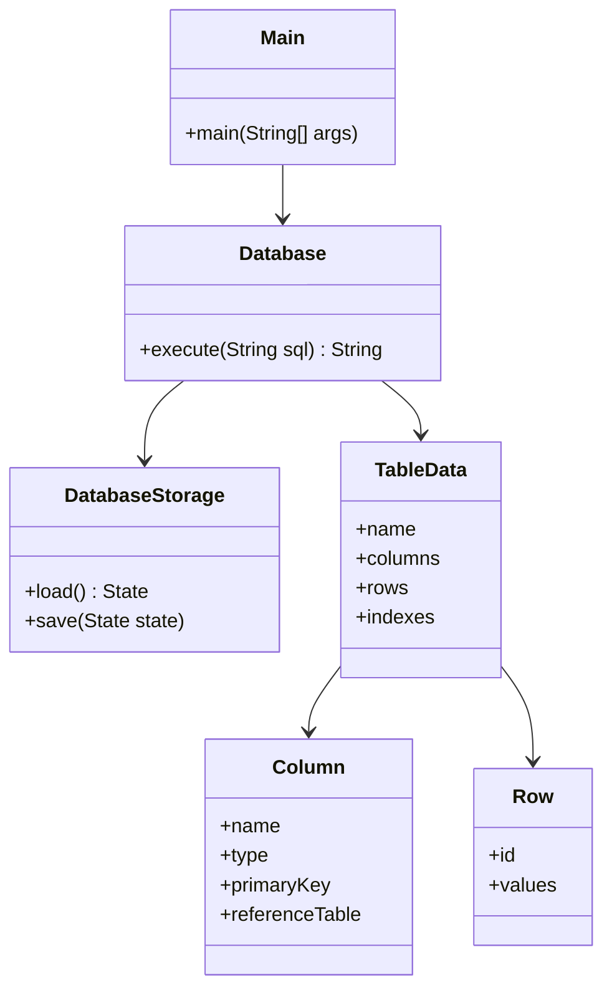
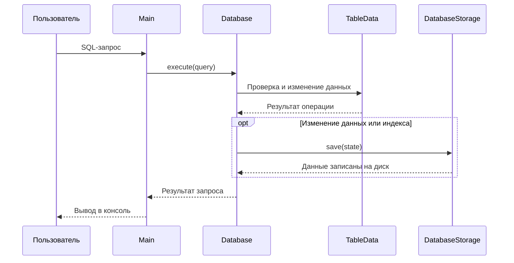

# MiniDB — упрощённая СУБД на Java

Консольная учебная СУБД. Данные и индексы сериализуются в файл `data/database.db` и загружаются при следующем запуске.

## Возможности

- Две связанные таблицы по умолчанию: `customers` и `orders`.
- Типы данных: `INT`, `DOUBLE`, `STRING` / `VARCHAR`, `DATE`, `BOOLEAN`.
- Проверка уникальности первичного ключа и внешних ключей.
- `INSERT` одной или нескольких записей, `SELECT`, `UPDATE`, `DELETE`.
- `CREATE TABLE`, `DROP TABLE`, `CREATE INDEX`.
- Условия `=`, `!=`, `<>`, `>`, `<`, `>=`, `<=`.
- Индексы сохраняются вместе с таблицами. При поиске по индексированному столбцу используется индекс, в том числе для сравнений диапазона.
- Сохранение изменений после каждой операции. Запись выполняется во временный файл с последующей заменой основного файла.

## Структура проекта

```text
minidb-java/
├── src/
│   ├── main/java/minidb/
│   │   ├── Main.java
│   │   ├── core/Database.java
│   │   ├── model/
│   │   │   ├── Column.java
│   │   │   ├── DataType.java
│   │   │   ├── Row.java
│   │   │   └── TableData.java
│   │   └── storage/DatabaseStorage.java
│   └── test/java/minidb/DatabaseTests.java
├── run.sh
├── test.sh
├── run.bat
├── test.bat
└── README.md
```

## Архитектура



### Последовательность выполнения запроса



`Database` отвечает за обработку SQL и правила целостности. `TableData` хранит структуру таблицы, строки и индексы. `DatabaseStorage` отвечает за загрузку и сохранение сериализованного состояния. Это разделение соответствует подходу Repository на уровне хранения данных.

## Запуск

Требуется JDK 8 или новее.

### Windows

Откройте папку проекта в терминале и выполните:

```bat
run.bat
```

### macOS / Linux

```bash
chmod +x run.sh
./run.sh
```

При первом запуске автоматически создаются пустые таблицы `customers` и `orders`. Файл базы данных появится в папке `data`. Для выхода введите `EXIT`.

## Примеры запросов

```sql
INSERT INTO customers VALUES (1, 'Anna', 'anna@mail.com', TRUE);
INSERT INTO customers (id, name) VALUES (2, 'Boris');

INSERT INTO orders VALUES (10, 1, 'Keyboard', 2500.0, '2026-11-12');

SELECT * FROM customers;
SELECT name, email FROM customers WHERE id >= 1;

UPDATE customers SET email = 'new@mail.com' WHERE id = 2;
DELETE FROM orders WHERE id = 10;

CREATE TABLE cars (id INT PRIMARY KEY, brand STRING, price DOUBLE, created DATE, available BOOLEAN);

INSERT INTO cars VALUES (1, 'Toyota', 25000.0, '2026-01-01', TRUE);
SELECT brand, price FROM cars WHERE price > 20000;
CREATE INDEX idx_cars_brand ON cars (brand);
SELECT * FROM cars WHERE brand = 'Toyota';
DROP TABLE cars;
```

Допустим также многострочный `INSERT` в одну команду:

```sql
INSERT INTO customers (id, name) VALUES (3, 'Dina'), (4, 'Oleg');
```

Названия таблиц и столбцов не заключаются в кавычки. Строки и даты задаются в одинарных кавычках. Формат даты — `YYYY-MM-DD`. Пропущенные при `INSERT` поля получают значение `NULL`, кроме первичного ключа.

## Ограничения парсера

Это учебное подмножество SQL, а не полноценный SQL-движок. Один ввод консоли содержит один запрос. В `WHERE` поддерживается одно простое условие сравнения; `AND`, `OR`, `JOIN`, подзапросы, сортировка, агрегатные функции и изменение схемы через `ALTER TABLE` не реализованы. Первичный ключ задаётся непосредственно в определении столбца: `id INT PRIMARY KEY`. Внешний ключ задаётся так: `customer_id INT REFERENCES customers(id)`. Удаление или изменение ключа, на который уже ссылаются записи, запрещено.

## Тестирование

Запуск функциональных и нагрузочных тестов:

**Windows:**

```bat
test.bat
```

**macOS / Linux:**

```bash
./test.sh
```

В тестах проверяются вставка одной и нескольких записей, уникальность первичного ключа, внешний ключ, типы данных, выборка с условиями, обновление, удаление, создание и удаление таблиц, индексы, сохранение данных и индексов после повторного открытия базы.

### Результаты последнего тестового запуска

- Функциональные проверки: **34/34 пройдены**.
- Нагрузочная проверка: 20 000 строк, 80 запросов `SELECT` по столбцу `category`.
- Без индекса: **40,66 мс**.
- С индексом: **11,38 мс**.
- Ускорение в этом запуске: **3,57 раза**.
- Результаты выборки с индексом и без индекса совпали.

Время замера зависит от компьютера и текущей нагрузки. Это результат одного запуска в тестовой среде с OpenJDK 21; код компилируется с целевой совместимостью Java 8.

## Надёжность

После каждой операции изменения состояние сохраняется в отдельный временный файл. Затем временный файл заменяет основной. Это снижает риск повредить последнюю сохранённую базу при прерывании записи. Полноценный журнал транзакций и восстановление незавершённых транзакций не реализованы.

## Командная работа

Работа выполнена одним разработчиком. Реализация, тестирование и документация выполнены в рамках одного проекта.

## Вывод

Реализована упрощённая файловая СУБД с двумя связанными таблицами, базовыми SQL-операциями, проверкой ключей, сериализацией и индексированием. Функциональные тесты подтвердили работу реализованных операций. В проведённом нагрузочном тесте индекс ускорил выборку по индексированному столбцу.

## Использованные источники

- Java Platform, Standard Edition 8 API: https://docs.oracle.com/javase/8/docs/api/
- Java Object Serialization Specification: https://docs.oracle.com/javase/8/docs/platform/serialization/spec/serialTOC.html
- Java Language Specification, Java SE 8: https://docs.oracle.com/javase/specs/jls/se8/html/
